<div align="center">

# MARVEList

**Il tuo universo. La tua timeline.**

Il diario personale dell'Universo Marvel: ordine di visione, progressi, voti, maratone pianificate in automatico, notizie e un assistente IA in stile J.A.R.V.I.S.


**[Prova MARVEList online](https://marvelist-frontend.onrender.com)**

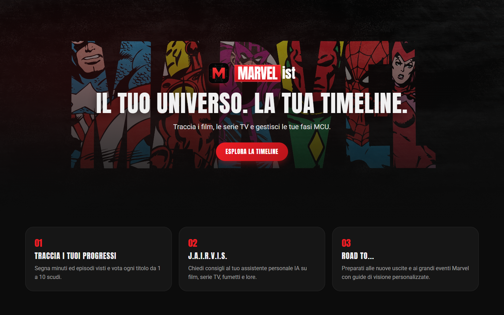

</div>

---

## Indice

- [Perché ho creato MARVEList](#perché-ho-creato-marvelist)
- [Panoramica delle funzionalità](#panoramica-delle-funzionalità)
- [Come funziona l'app, pagina per pagina](#come-funziona-lapp-pagina-per-pagina)
- [J.A.I.R.V.I.S., l'assistente IA](#jairvis-lassistente-ia)
- [Architettura](#architettura)
- [Tecnologie e motivazioni](#tecnologie-e-motivazioni)
- [La logica più interessante](#la-logica-più-interessante)
- [Sicurezza](#sicurezza)
- [Struttura del progetto](#struttura-del-progetto)
- [Avviare il progetto in locale](#avviare-il-progetto-in-locale)
- [Deploy su Render](#deploy-su-render)
- [Test](#test)
- [Cosa ho imparato e sviluppi futuri](#cosa-ho-imparato-e-sviluppi-futuri)

---

## Perché ho creato MARVEList

Sono un grande fan Marvel e, come tanti, mi sono perso più volte tra film, serie Disney+, vecchi film Fox, serie Netflix e animazione. Le app di tracking generiche trattano ogni titolo come un elemento a sé, ma nel mondo Marvel **l'ordine conta**: una serie spiega un film, un One-Shot va visto subito dopo un certo titolo, e prima di un grande evento bisogna sapere cosa recuperare.

Per il mio progetto Capstone ho quindi deciso di costruire l'app che avrei voluto usare io: un posto unico dove seguire l'ordine di visione, segnare cosa ho visto, organizzarmi le maratone e chiedere consigli a un assistente che "parla Marvel".

---

## Panoramica delle funzionalità

| Area | Cosa si può fare |
| --- | --- |
| **Timeline** | Tre livelli di visione (MCU, Marvel Fan, Marvel GOD), titoli divisi per fase in accordion, ricerca, presa visione di un'intera fase |
| **Schede titolo** | Trama, cast e trailer da TMDB, minuti visti per i film, episodi per le serie, voto da 0,5 a 10 scudi, preferiti, "Guarda dopo" |
| **Profilo** | Statistiche (film, serie, ore di visione, voto medio), grado da *Recluta S.H.I.E.L.D.* a *GOD OF MARVEL*, nickname e avatar, "Continua a guardare", preferiti |
| **Maratone** | Scelgo titoli, date e ritmo (film a settimana, episodi al giorno) e l'app genera il calendario giorno per giorno |
| **Road To** | Percorsi pronti per prepararsi ai grandi eventi: *Doomsday*, *Endgame*, *Spiderverse* |
| **News** | Le notizie Marvel degli ultimi 14 giorni in stile *Daily Bugle*, con collegamento alle schede del catalogo |
| **J.A.I.R.V.I.S.** | Chat con un'IA esperta di MCU, fumetti e serie, che conosce anche il funzionamento dell'app |
| **FAQ** | 24 domande e risposte con ricerca e filtri, presentate dall'Osservatore |
| **Account** | Registrazione con conferma via email, login con JWT |

---

## Come funziona l'app, pagina per pagina

### Home, registrazione e accesso

La landing page presenta l'app e porta alla Timeline. Le pagine sono responsive: su mobile lo sfondo con il logo MARVEL si adatta alla larghezza dello schermo invece di essere tagliato.

<p align="center">
  
  &nbsp;&nbsp;
  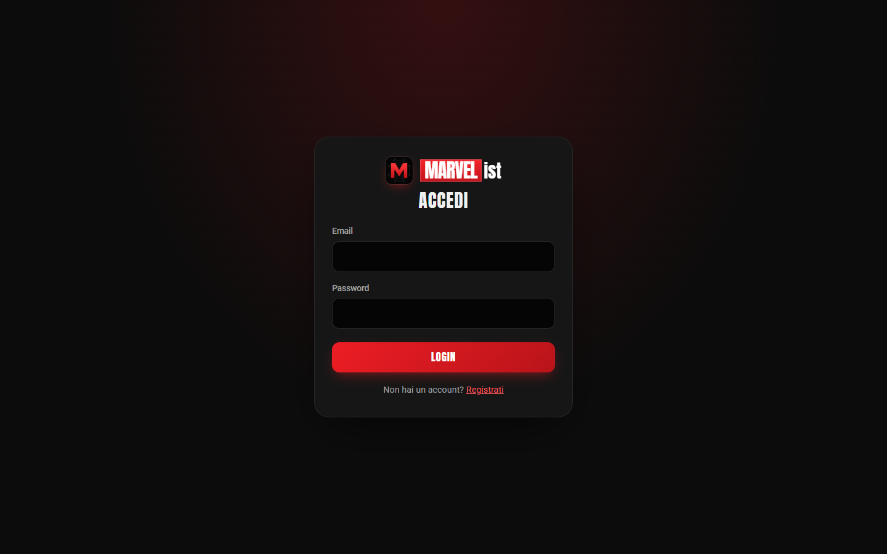
</p>

Per registrarmi inserisco nome, cognome, email e una password robusta. L'account resta **disattivato** finché non clicco il link che ricevo per email (template HTML con i colori Marvel). Il link scade dopo 24 ore. Dopo il login il backend restituisce un **token JWT**, che il frontend salva e allega a ogni richiesta.

### Timeline: il cuore dell'app

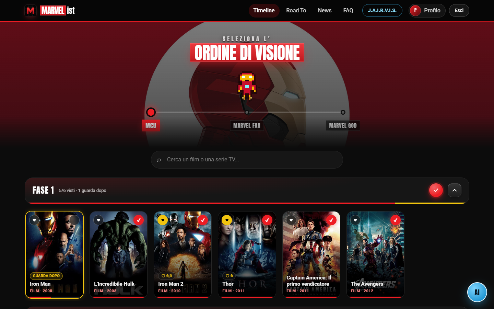

In cima c'è uno slider con tre livelli di visione, ognuno con il suo tema di colore e un personaggio animato a 8 bit disegnato in puro CSS:

- **MCU**: solo i film e le serie principali (la "Sacra Linea Temporale"). Iron Man che galleggia.
- **Marvel Fan**: aggiunge i progetti del Multiverso canonizzati (Spider-Man di Tobey Maguire e Andrew Garfield, Daredevil Netflix…). Wolverine sfodera gli artigli.
- **Marvel GOD**: tutto ciò che ha il logo Marvel, compresi i film Fox, le serie ABC e l'animazione. Capitan America afferra lo scudo e lo lancia.

I titoli sono divisi per fase in **accordion**. Ogni fase mostra il conteggio dei visti, una barra di avanzamento e un anello che, cliccato, segna come vista (o azzera) l'intera fase.

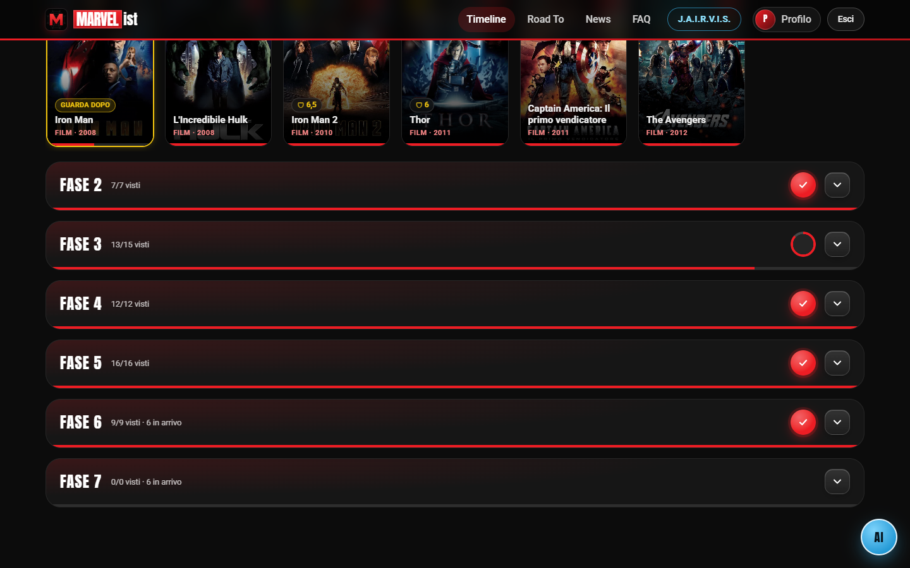

Ogni card ha un cuore per i preferiti, un cerchio per il "visto" e una sottile barra con la percentuale vista. I titoli non ancora usciti mostrano la fascia **IN ARRIVO** con la data di uscita e non contano nei progressi.

Alla prima apertura della sessione parte un'intro animata con le Gemme dell'Infinito:

<p align="center"></p>

### Scheda del titolo

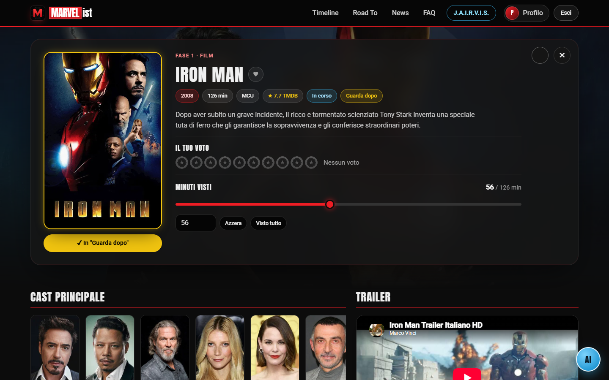

Da ogni card si apre la scheda, con dati presi in tempo reale da **TMDB**: trama, durata, voto TMDB, cast principale e trailer YouTube. Qui posso:

- per i **film**, segnare i minuti visti con lo slider e salvarli: il film finisce in "Continua a guardare" e, a durata completa, diventa visto da solo;
- per le **serie**, toccare i singoli episodi o il pulsante **ALL**;
- dare un **voto a scudi** di Capitan America da 0,5 a 10 (metà scudo = mezzo voto);
- aggiungerlo ai **preferiti**;
- metterlo in **"Guarda dopo"**.

**"Guarda dopo"** serve quando voglio rimandare un titolo senza bloccare i miei progressi. La locandina prende un bordo giallo e il titolo:

- nella barra della fase conta come "fatto", con un tratto giallo: se manca solo lui la fase risulta completa;
- nelle maratone esce dal calendario e dal totale;
- **non** conta per il grado del profilo: per diventare *Eroe* devo aver visto davvero tutto l'MCU.

<p align="center">
  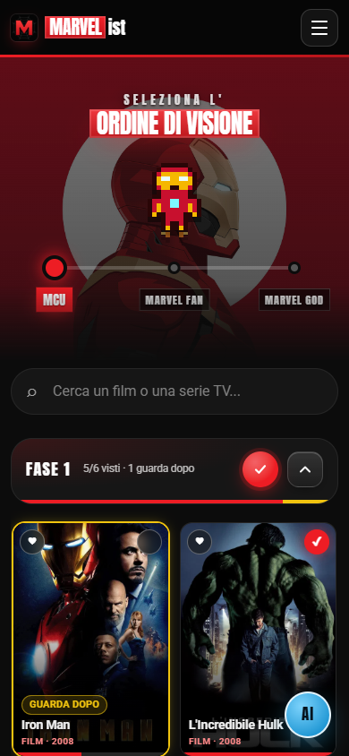
  &nbsp;&nbsp;
  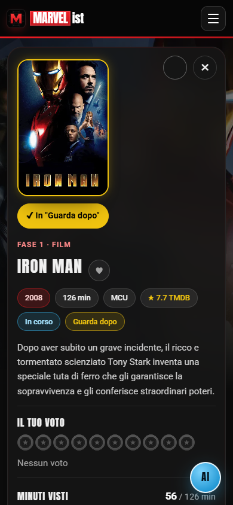
</p>

### Profilo e gradi

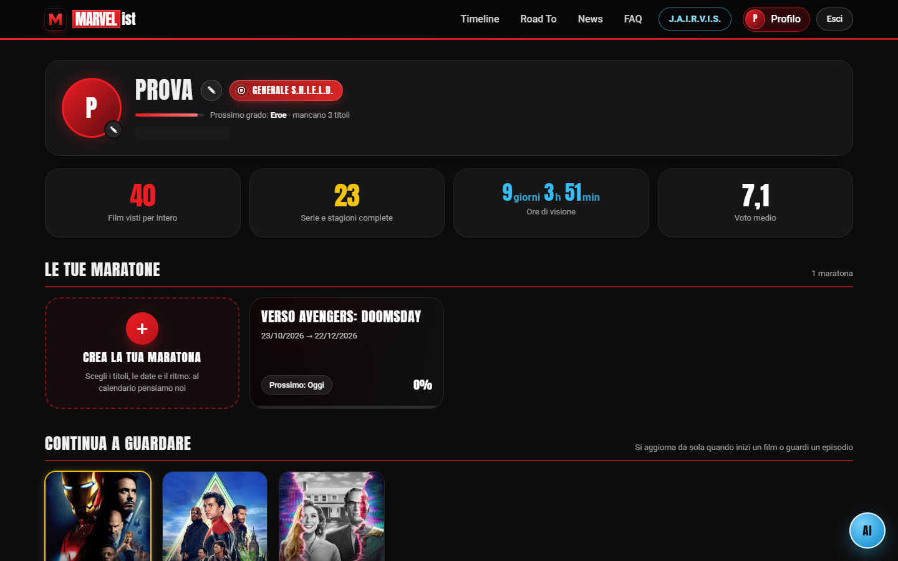

Il profilo riassume tutto: film visti per intero, serie e stagioni complete, **ore di visione** (contano anche i titoli lasciati a metà) e voto medio. Posso cambiare nickname e scegliere uno degli emblemi Marvel come avatar.

Il **badge del grado** cresce con quello che ho completato, seguendo i tre livelli della Timeline:

| Livello | Gradi |
| --- | --- |
| MCU (rossi) | Recluta S.H.I.E.L.D. → Soldato → Generale S.H.I.E.L.D. → **Eroe** (100% MCU) |
| Marvel Fan (gialli) | Avenger → Avenger OG → **Planet Avenger** (100% Marvel Fan) |
| Marvel GOD (celesti) | Solar → Universe → Galaxy → Multiverse Avenger → **GOD OF MARVEL** |

Sotto il badge c'è sempre l'indicazione del prossimo grado e di quanti titoli mancano. Più in basso trovo le mie maratone, **"Continua a guardare"** (la watchlist automatica dei titoli iniziati ma non finiti) e i preferiti.

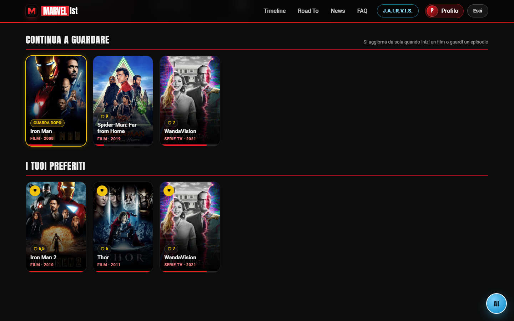

### Maratone

<p align="center">
  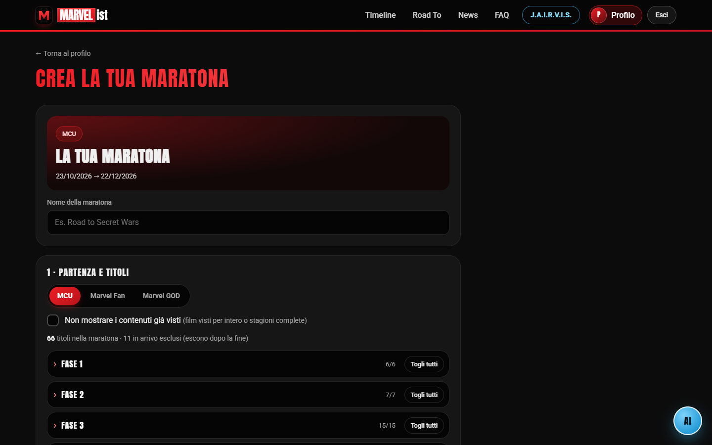
  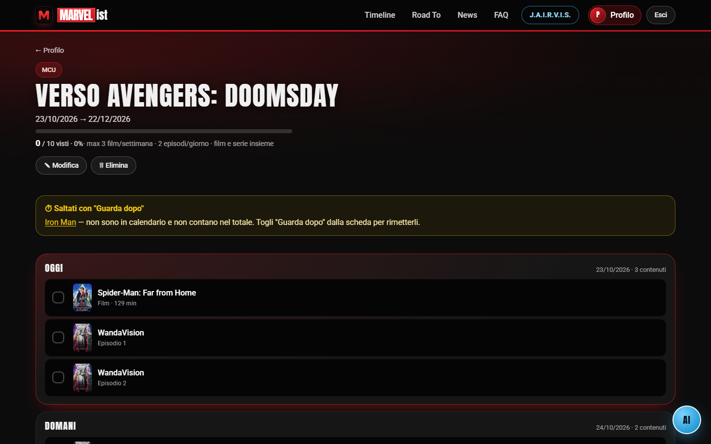
</p>

Una maratona si crea in pochi passi:

1. scelgo nome, sfondo (un'immagine caricata o la locandina di un titolo) e il livello di partenza;
2. tolgo i titoli che non mi interessano, eventualmente nascondendo quelli già visti;
3. imposto date di inizio e fine, **film a settimana**, **episodi al giorno** e se mescolare film e serie nello stesso giorno.

Mentre compilo il form, il backend calcola un'**anteprima del piano**. Se non c'è il tempo materiale, mi avvisa prima di salvare e mi propone la data di fine minima. Una volta creata, la maratona diventa un calendario "Oggi / Domani / …": spunto quello che guardo e risulta visto anche nel profilo. Se salto un giorno, quello che non ho visto scivola automaticamente sui giorni successivi.

### Road To

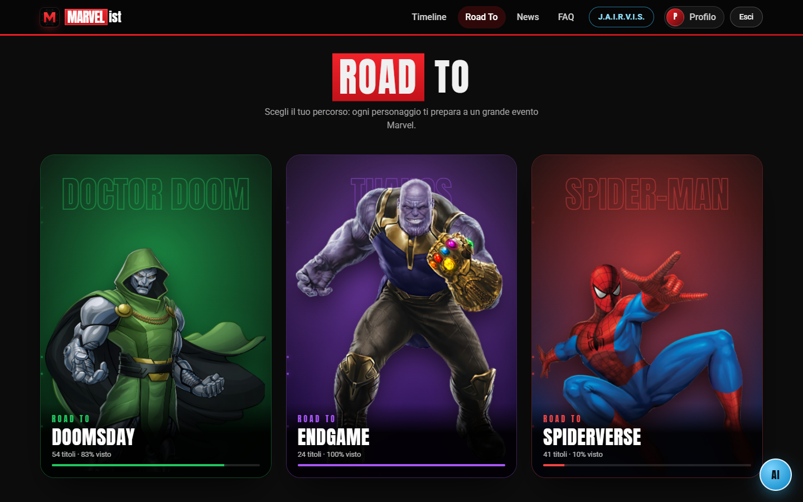

Tre percorsi pronti, ognuno guidato da un personaggio con le sue animazioni e il suo colore:

- **Road to Doomsday** (Doctor Doom): tutto quello che serve prima di *Avengers: Doomsday*;
- **Road to Endgame** (Thanos): la saga dell'Infinito;
- **Road to Spiderverse** (Spider-Man): tutte le versioni dell'Uomo Ragno.

Selezionando una card compaiono gli accordion del percorso, con le stesse funzioni della Timeline.

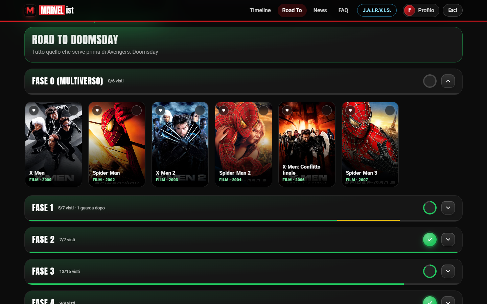

### News: il Daily Bugle

<p align="center">
  
  
</p>

Le notizie arrivano dal feed RSS di **Google News** in italiano (articoli Marvel degli ultimi 14 giorni) e sono impaginate come la prima pagina del *Daily Bugle*. Ci sono un articolo in apertura, le ultime notizie, le prossime uscite e una ricerca. Se un articolo parla di un titolo del catalogo, accanto compare il link alla sua scheda: il riconoscimento usa il nome più lungo trovato nel testo, così "Avengers: Doomsday" vince su "Avengers".

### FAQ

<p align="center">
  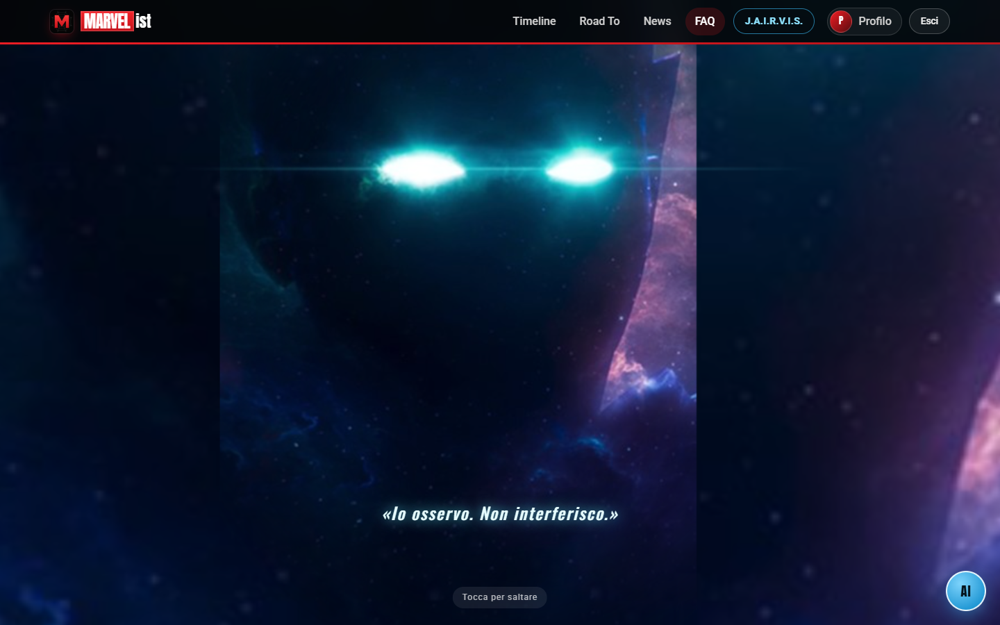
  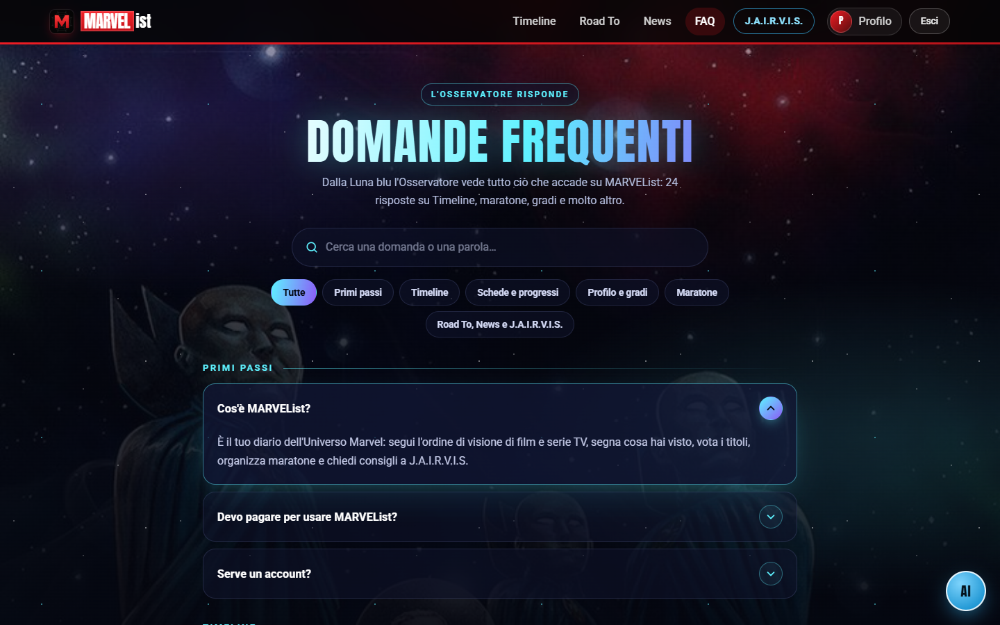
</p>

L'Osservatore dalla Luna blu risponde alle domande frequenti, divise per sezione, con ricerca e filtri. Le stesse FAQ sono anche la "base di conoscenza" di J.A.I.R.V.I.S.

---

## J.A.I.R.V.I.S., l'assistente IA

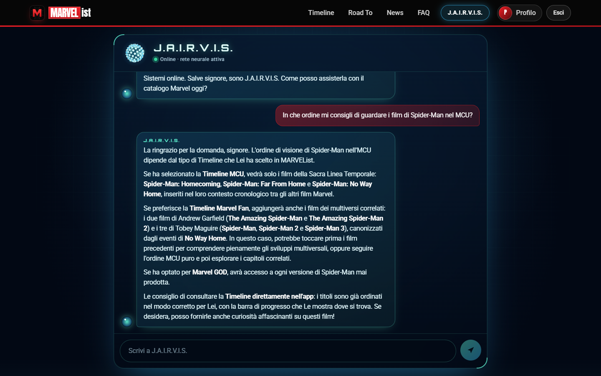

**J.A.I.R.V.I.S.** (gioco di parole tra *J.A.R.V.I.S.* e *AI*) è l'assistente personale dell'app, ispirato all'IA di Tony Stark. Lo raggiungo dal menu o dal pulsante flottante **AI**, che si nasconde mentre scorro per non coprire le card.

### Caratteristiche

- **Esperto Marvel**: risponde su MCU, fumetti, serie TV, scene post-credit e consigli su cosa guardare.
- **Conosce MARVEList**: a ogni domanda il frontend invia anche il testo di tutte le FAQ. Così J.A.I.R.V.I.S. spiega Timeline, maratone, gradi o "Guarda dopo" in linea con l'app reale, senza inventare funzioni che non esistono. Se la domanda riguarda l'app ma non è coperta, lo dice e rimanda alla pagina FAQ.
- **Personalità coerente**: dà **sempre del Lei** all'utente, mai del tu, anche quando l'utente scrive in modo informale. Lo chiama "signore" con naturalezza e mantiene il tono del maggiordomo digitale: deferente, discreto, con una punta di ironia britannica.
- **Risposte leggibili**: il modello risponde in markdown leggero (grassetto per i titoli, elenchi per gli ordini di visione). Il frontend lo trasforma in testo formattato con un piccolo parser scritto da me, senza mai iniettare HTML: React fa l'escape di tutto.
- **Domande rapide**: suggerimenti pronti come "In che ordine guardo l'MCU?" o "Spiegami il Multiverso".
- **Interfaccia da laboratorio Stark**: una sequenza di avvio ("Inizializzazione rete neurale…") e un **globo di neuroni** animato su `<canvas>`, con nodi disposti su una spirale di Fibonacci e impulsi luminosi che viaggiano lungo le sinapsi.
- **Errori gestiti con stile**: se il servizio non risponde, J.A.I.R.V.I.S. si scusa ("I miei sistemi di comunicazione sono temporaneamente offline, signore") invece di mostrare un errore tecnico.

### Come funziona dietro le quinte

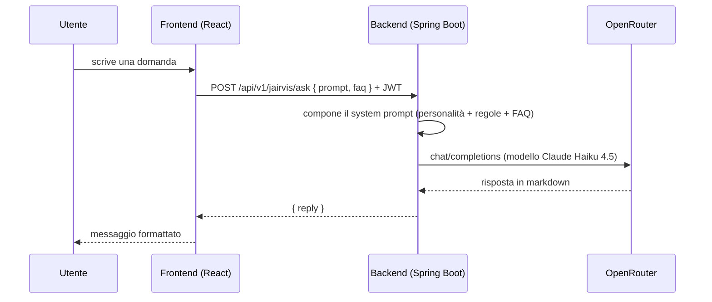

Ho scelto di **passare dal backend** e non chiamare l'IA direttamente dal browser per due motivi: la chiave API resta segreta sul server e solo gli utenti autenticati possono usare l'assistente. Come provider uso **OpenRouter**, che con un'unica API mi permette di cambiare modello modificando una stringa. Ho scelto **Claude Haiku 4.5** perché è veloce, economico e molto bravo a rispettare le istruzioni di tono e formattazione.

---

## Architettura

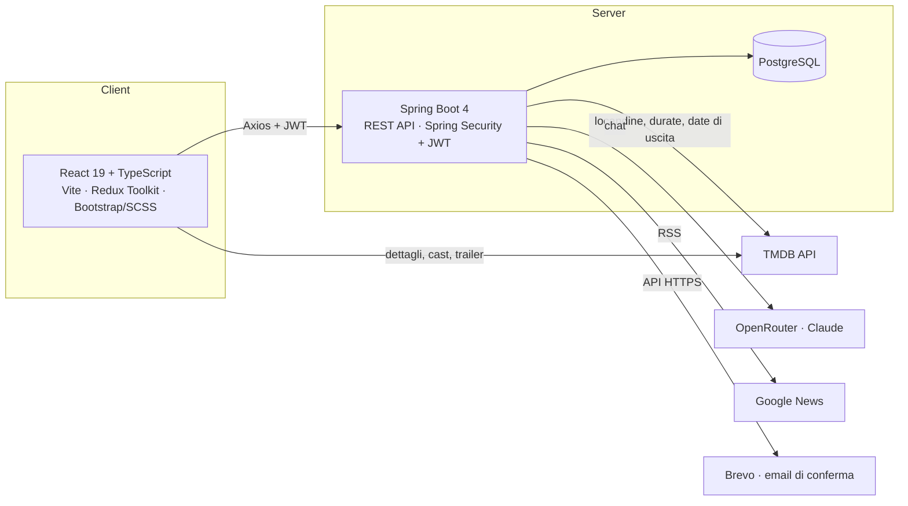

- Il **catalogo** (285 titoli) vive nel file `marvel_data.json` del backend, nell'ordine di visione. A ogni avvio il `DataSeeder` lo sincronizza con il database, usando titolo + anno come chiave: aggiorna i titoli esistenti **mantenendo gli ID**, e quindi i "visti" degli utenti, e inserisce i nuovi.
- Il `PosterSyncService` completa in background i dati mancanti da TMDB (locandine, durate, episodi) e ogni giorno ricontrolla le date di uscita dei titoli in arrivo.
- Il frontend chiede a TMDB solo i dettagli "di contorno" della scheda (trama, cast, trailer) e salva nel database gli ID e le locandine che trova, così la volta dopo arrivano già dal backend.

---

## Tecnologie e motivazioni

### Frontend

| Tecnologia | Perché l'ho scelta |
| --- | --- |
| **React 19** | È la libreria su cui mi sono formato. Il modello a componenti è perfetto per un'interfaccia fatta di elementi ripetuti (card, accordion, chip) e l'ecosistema è enorme. |
| **TypeScript** | Con tanti dati che viaggiano tra backend, TMDB e componenti (progressi, maratone, notizie), i tipi mi hanno evitato moltissimi bug e reso il refactoring molto più sicuro. |
| **Vite** | Avvio del dev server istantaneo e hot reload rapidissimo. Rispetto a Create React App (ormai deprecato) la differenza si sente ogni giorno. |
| **Redux Toolkit** | Per lo stato globale di autenticazione (token e profilo), letto da navbar, pagine protette e profilo. Toolkit elimina quasi tutto il codice ripetitivo del Redux classico. |
| **React Router 7** | Routing lato client con parametri (`/media/:id`, `/marathons/:id/edit`) e navigazione "indietro" che ripristina filtri, fasi aperte e scroll. |
| **Axios** | Un'unica istanza con un *interceptor* che allega il JWT a ogni chiamata: non devo ricordarmelo in ogni servizio. |
| **Bootstrap 5 + SCSS** | Bootstrap mi dà una griglia responsive solida. Tutto lo stile Marvel (temi per livello, animazioni, card in vetro) l'ho scritto in SCSS con variabili CSS, così cambiare tema è solo questione di cambiare `--accent`. |
| **Vitest** | Si integra con Vite senza configurazione e ha la stessa API di Jest. Lo uso per testare la logica pura: gradi, ordinamenti, notizie, progressi. |
| **ESLint** | Per mantenere il codice coerente e intercettare errori con gli hook di React. |

Non ho usato librerie di animazione né di grafica: le intro, i personaggi a 8 bit (ogni pixel è un `box-shadow`), le card in 3D delle Road To e il globo neurale sono fatti a mano in CSS e Canvas. È stato il modo migliore per imparare davvero come funzionano.

### Backend

| Tecnologia | Perché l'ho scelta |
| --- | --- |
| **Java 21** | Versione LTS moderna: *record* per i DTO immutabili, *pattern matching* e API più espressive. |
| **Spring Boot 4** | Lo standard per le API REST in Java: configurazione automatica, dependency injection e un modulo pronto per ogni esigenza (web, sicurezza, JPA). |
| **Spring Data JPA + Hibernate** | Le relazioni (utenti, titoli visti, preferiti, progressi, maratone) si modellano come entità. I repository generano le query dal nome del metodo (`findAllByUserOrderByStartDateAscIdAsc`). |
| **PostgreSQL** | Database relazionale affidabile e gratuito. I dati dell'app sono fortemente relazionali e servono vincoli di integrità (un solo progresso per utente e titolo). |
| **Spring Security + JWT (jjwt)** | Autenticazione *stateless*: niente sessioni sul server, ogni richiesta porta il suo token. È l'ideale con un frontend separato. |
| **Bean Validation** | Le regole dei dati in ingresso (email valida, password robusta) sono annotazioni sul DTO e i messaggi d'errore arrivano già in italiano al frontend. |
| **Lombok** | Elimina getter, setter, costruttori e builder ripetitivi e lascia le entità leggibili. |
| **Maven** | Gestione delle dipendenze e build standard, con wrapper incluso (`mvnw`). |

### Servizi esterni

| Servizio | Uso |
| --- | --- |
| **TMDB** | Locandine, trame, cast, trailer, durate, episodi e date di uscita |
| **OpenRouter** (Claude Haiku 4.5) | Il "cervello" di J.A.I.R.V.I.S. |
| **Google News RSS** | Le notizie del Daily Bugle, lette dal backend perché il browser le bloccherebbe per CORS |
| **Brevo** | Invio delle email di conferma tramite API HTTPS, con template HTML in stile Marvel |
| **Render** | Hosting di frontend, backend e database |

---

## La logica più interessante

### Il pianificatore delle maratone

`MarathonScheduler` è la parte di cui vado più fiero. Trasforma una lista di titoli in un calendario rispettando:

- l'**ordine di visione**, che non si salta mai: se un film non entra oggi, tutto ciò che viene dopo slitta a domani;
- il limite di **film a settimana** (azzerato ogni lunedì) e di **episodi al giorno**;
- la scelta di **mescolare o separare** film e serie nello stesso giorno;
- i **titoli in arrivo**, che non vengono messi prima della loro data di uscita;
- i titoli in **"Guarda dopo"**, che vengono saltati.

Il calendario parte **sempre da oggi**, così quello che non ho visto nei giorni passati si sposta da solo. Quello che spunto oggi resta nel giorno, barrato, fino a mezzanotte, per non "tirare" su oggi i contenuti di domani. Se il piano non entra nelle date scelte, l'algoritmo simula fino a 10 anni in avanti per trovare la **data di fine minima** da proporre.

### Progressi sempre coerenti

Ho voluto che "visto", minuti ed episodi non potessero mai contraddirsi:

- segnare un titolo come visto completa anche minuti ed episodi, toglierlo li azzera;
- arrivare all'ultimo minuto o all'ultimo episodio lo segna come visto in automatico;
- la watchlist "Continua a guardare" non si gestisce a mano: si ricava dai titoli iniziati ma non finiti.

### Il sistema dei gradi

Il grado segue i livelli della Timeline: i titoli Marvel Fan visti "restano da parte" finché l'MCU non è completo, e lo stesso vale per Marvel GOD. I titoli non ancora usciti non contano come mancanti. Il calcolo è una funzione pura in TypeScript, coperta da test.

### Esperienza d'uso curata

- **Aggiornamenti ottimistici**: cuori, cerchi e voti cambiano subito e tornano indietro solo se il server risponde con un errore.
- **Memoria di pagina**: tornando indietro da una scheda ritrovo filtri, fasi aperte e posizione di scroll.
- **Caricamento pigro** delle locandine mancanti: vengono cercate su TMDB solo quando la card entra nello schermo (`IntersectionObserver`).
- **Responsive** su tutte le pagine, dalla Timeline al calendario delle maratone.

---

## Sicurezza

- Password salvate con **BCrypt**, mai in chiaro.
- **JWT** firmato, con scadenza a 24 ore. Sono pubbliche solo le rotte di autenticazione e le notizie.
- Account attivo **solo dopo la conferma via email**. Il link porta all'origine del frontend solo se questa è tra quelle ammesse dal CORS, così il token non può essere dirottato su un sito esterno.
- **CORS** limitato a `localhost` e alla rete di casa; online, solo al dominio del frontend.
- Ogni maratona e ogni progresso è legato all'utente del token: non si possono leggere o modificare i dati di altri.
- Il parser del feed RSS ha **DTD ed entità esterne disattivate** (protezione da XXE).
- Le **chiavi segrete** (database, JWT, TMDB, OpenRouter, email) non sono nel codice: in locale arrivano da un file `.env` escluso da git, online dalle variabili d'ambiente di Render.

---

## Struttura del progetto

```text
CAPSTONE/
├── render.yaml                    # Blueprint di Render: frontend, backend e database
├── marvelist-frontend/            # React + TypeScript + Vite
│   ├── docs/screenshots/          # gli screenshot di questo README
│   └── src/
│       ├── components/            # card, accordion, intro animate, globo neurale, rating a scudi…
│       ├── pages/                 # Home, Timeline, MediaDetail, Profile, Marathon*, RoadTo, News, Faq, Jairvis…
│       ├── services/              # chiamate al backend (Axios) e a TMDB
│       ├── hooks/                 # useWatchState (stato condiviso Timeline/Road To), usePageMemory
│       ├── store/                 # Redux Toolkit: autenticazione e profilo
│       ├── utils/                 # gradi, ordinamenti, notizie, FAQ, progressi (+ test Vitest)
│       └── styles/main.scss       # tutto lo stile dell'app
│
└── marvelist-backend/             # Spring Boot 4 + Java 21
    ├── Dockerfile                 # immagine per il deploy su Render
    └── src/main/
        ├── java/com/marvelist/backend/
        │   ├── auth/              # registrazione, conferma email, login
        │   ├── security/          # Spring Security, filtro e servizio JWT
        │   ├── controllers/       # REST: media, maratone, utenti, news, jairvis
        │   ├── services/          # logica: MarathonScheduler, MediaService, JairvisService, NewsService…
        │   ├── entities/          # User, Media, UserProgress, Marathon, MarathonItem…
        │   ├── dto/               # oggetti di richiesta/risposta
        │   ├── repositories/      # Spring Data JPA
        │   └── config/            # DataSeeder, CORS, gestione errori
        └── resources/
            ├── marvel_data.json   # il catalogo nell'ordine di visione
            └── templates/email/   # template HTML della mail di conferma
```

### Principali endpoint REST

| Metodo | Endpoint | Descrizione |
| --- | --- | --- |
| `POST` | `/api/v1/auth/register` | Registrazione (invia la mail di conferma) |
| `GET` | `/api/v1/auth/verify?token=…` | Conferma dell'account |
| `POST` | `/api/v1/auth/authenticate` | Login, restituisce il JWT |
| `GET` | `/api/v1/media` | Catalogo nell'ordine di visione |
| `POST` | `/api/v1/media/{id}/seen` | Visto / non visto |
| `POST` | `/api/v1/media/bulk-seen` | Presa visione di un'intera fase |
| `PUT` | `/api/v1/media/{id}/progress` | Minuti o episodi visti |
| `PUT` | `/api/v1/media/{id}/rating` | Voto a scudi |
| `POST` | `/api/v1/media/{id}/favorite` | Preferito |
| `POST` | `/api/v1/media/{id}/watch-later` | "Guarda dopo" |
| `GET` | `/api/v1/media/progress` | Tutti i progressi dell'utente |
| `GET/POST` | `/api/v1/marathons` | Elenco e creazione delle maratone |
| `POST` | `/api/v1/marathons/preview` | Anteprima del piano senza salvare |
| `POST` | `/api/v1/marathons/{id}/check` | Spunta di un film o di un episodio |
| `GET/PUT` | `/api/v1/users/me` | Profilo (nickname e avatar) |
| `GET` | `/api/v1/news` | Notizie del Daily Bugle (pubblico) |
| `POST` | `/api/v1/jairvis/ask` | Domanda a J.A.I.R.V.I.S. |

---

## Avviare il progetto in locale

### Requisiti

- **Node.js** 20.19 o superiore (richiesto da Vite 8)
- **Java 21** (JDK)
- **PostgreSQL** con un database chiamato `marvelist`
- Una chiave API di [TMDB](https://www.themoviedb.org/settings/api) e una di [OpenRouter](https://openrouter.ai/keys)
- Un account [Brevo](https://www.brevo.com) con una chiave API e un mittente verificato (per le email di conferma)

### 1. Backend

```bash
cd marvelist-backend
cp .env.example .env        # poi compila i valori
```

Il file `.env` contiene:

```properties
DB_PASSWORD=la_password_di_postgres
JWT_SECRET_KEY=una_chiave_base64_di_256_bit
TMDB_API_KEY=...
OPENROUTER_API_KEY=...
BREVO_API_KEY=la_chiave_api_di_brevo
MAIL_FROM=indirizzo.mittente@verificato.su.brevo
```

Poi avvio il server, che parte su `http://localhost:8080`:

```bash
./mvnw spring-boot:run      # su Windows: mvnw.cmd spring-boot:run
```

Al primo avvio Hibernate crea le tabelle, il `DataSeeder` carica il catalogo dal JSON e in background vengono completate locandine e durate da TMDB.

### 2. Frontend

```bash
cd marvelist-frontend
cp .env.example .env        # poi inserisci la chiave TMDB
npm install
npm run dev
```

Il file `.env` del frontend contiene `VITE_TMDB_API_KEY`, usata per cast, trailer e locandine nelle schede dei titoli.

L'app è su `http://localhost:5173`. Di default il frontend chiama il backend sulla porta 8080 dello stesso host, quindi funziona anche da telefono sulla rete di casa. Per un indirizzo diverso basta impostare `VITE_API_URL`.

### Script disponibili (frontend)

| Comando | Cosa fa |
| --- | --- |
| `npm run dev` | Server di sviluppo con hot reload |
| `npm run build` | Controllo dei tipi + build di produzione in `dist/` |
| `npm run preview` | Anteprima della build |
| `npm run lint` | ESLint |
| `npm test` | Test Vitest |

---

## Deploy su Render

MARVEList è online su [Render](https://render.com), con tutti e tre i pezzi sul piano gratuito:

| Servizio | Tipo su Render | Indirizzo |
| --- | --- | --- |
| Frontend | Static Site | [marvelist-frontend.onrender.com](https://marvelist-frontend.onrender.com) |
| Backend | Web Service (Docker) | [marvelist-backend.onrender.com](https://marvelist-backend.onrender.com/api/v1/news) |
| Database | PostgreSQL | rete privata di Render |

L'intera infrastruttura è descritta nel file [`render.yaml`](render.yaml) (*Blueprint*): Render crea i tre servizi, li collega tra loro e rifà il deploy a ogni push su `main`. Ogni servizio guarda solo la propria cartella, quindi una modifica al README non riavvia nulla.

### Le scelte per la produzione

- **Backend in Docker**: Render non ha un runtime Java nativo, quindi il `Dockerfile` compila il progetto con Maven e lo avvia su una JRE 21. All'avvio converte l'indirizzo del database fornito da Render nel formato JDBC.
- **Email via API HTTPS**: il piano gratuito di Render blocca le porte SMTP, quindi le mail di conferma partono da [Brevo](https://www.brevo.com) con una semplice chiamata REST. Il logo della mail è servito dal frontend (`/email/marvelist-logo.png`).
- **Routing lato client**: una regola di *rewrite* manda ogni percorso a `index.html`, così ricaricare `/timeline` o `/media/42` non dà 404.
- **Configurazione dall'ambiente**: database, porta, CORS, indirizzo del frontend e log SQL si impostano con variabili d'ambiente; in locale valgono i default di sempre.

### Rifare il deploy da zero

1. **Brevo**: creo un account gratuito, in *Senders, Domains & Dedicated IPs* aggiungo e verifico l'indirizzo mittente, poi in *SMTP & API → API Keys* genero una chiave API.
2. **Render**: dalla dashboard scelgo *New → Blueprint*, collego il repository GitHub e Render legge `render.yaml`.
3. Inserisco i valori richiesti: `TMDB_API_KEY`, `OPENROUTER_API_KEY`, `BREVO_API_KEY`, `MAIL_FROM` (il mittente verificato su Brevo) e `VITE_TMDB_API_KEY`. La chiave JWT e le credenziali del database vengono generate da Render.
4. Avvio il deploy: prima il database, poi il backend (al primo avvio crea le tabelle e carica il catalogo), infine il frontend.

### Limiti del piano gratuito

- Il backend va in pausa dopo circa 15 minuti senza visite: la prima richiesta dopo la pausa può richiedere un minuto, poi l'app torna veloce.
- Il database gratuito scade dopo 30 giorni; basta ricrearne uno dal Blueprint.
- Brevo gratuito consente fino a 300 email al giorno.

---

## Test

- **Frontend (Vitest)**: 28 test sulla logica pura. Calcolo dei gradi, ordinamento per fase e livello, riconoscimento dei titoli nelle notizie, percentuali di avanzamento e accorciamento delle trame.
- **Backend (JUnit)**: test su quattro aree.
  - Il **pianificatore delle maratone**: limiti settimanali e giornalieri, giorni misti, titoli in arrivo, data di fine minima, ordine di visione mai scavalcato.
  - La **registrazione con conferma via email**: account disattivato, link scaduto o già usato, token inesistente.
  - Il **link nelle email**: punta solo a origini ammesse.
  - Il **feed delle notizie**: ordinamento, doppioni, date non valide, rifiuto dei DTD.

```bash
# frontend
npm test

# backend
./mvnw test
```

---

## Cosa ho imparato e sviluppi futuri

Questo progetto mi ha fatto lavorare su tutto lo stack: dalla modellazione del database alla sicurezza con JWT, dall'integrazione con API esterne e un modello di IA fino alle animazioni in CSS puro. Le sfide più grandi sono state:

- scrivere un algoritmo di pianificazione che rispettasse insieme ordine, limiti e date di uscita;
- tenere sempre coerenti "visto", minuti ed episodi tra Timeline, schede, maratone e profilo;
- rendere J.A.I.R.V.I.S. affidabile sulle funzioni dell'app, dandogli come contesto le FAQ invece di lasciarlo "inventare".

Tra le idee per il futuro:

- far uscire in automatico i titoli "in arrivo" alla loro data di uscita, senza modificare il JSON;
- una memoria della conversazione per J.A.I.R.V.I.S., così da poter fare domande di seguito;
- maratone condivisibili con gli amici;
- notifiche per le nuove uscite e per i giorni di maratona;
- un'app installabile (PWA) per usarla come un'app nativa sul telefono.

---

<div align="center">

Progetto Capstone realizzato da **Marco Cozma**.

</div>
